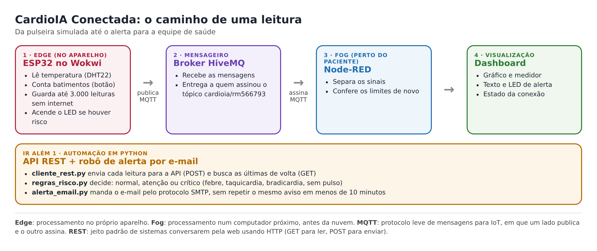
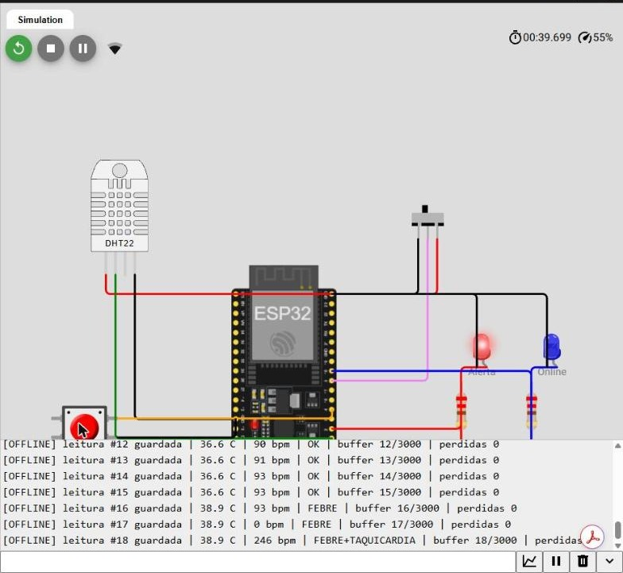
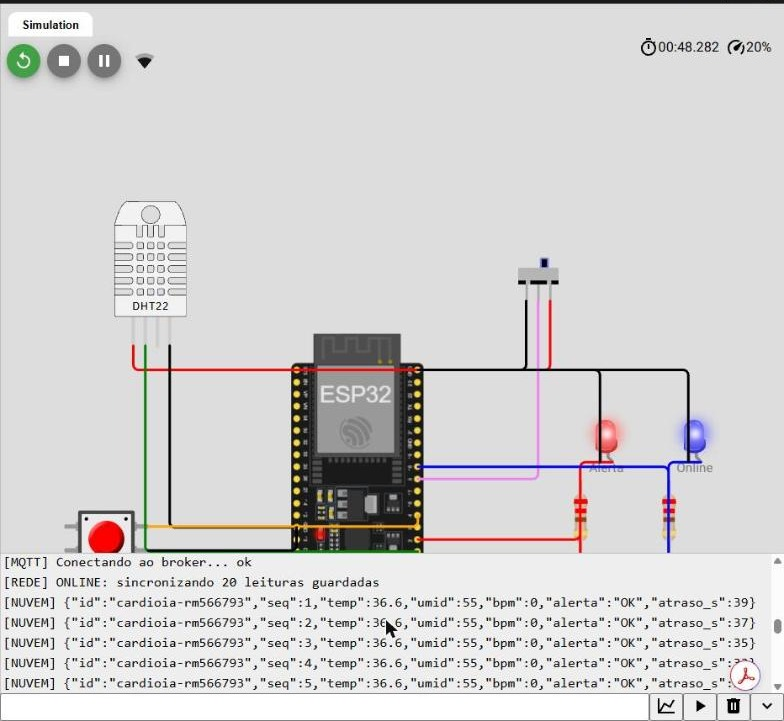
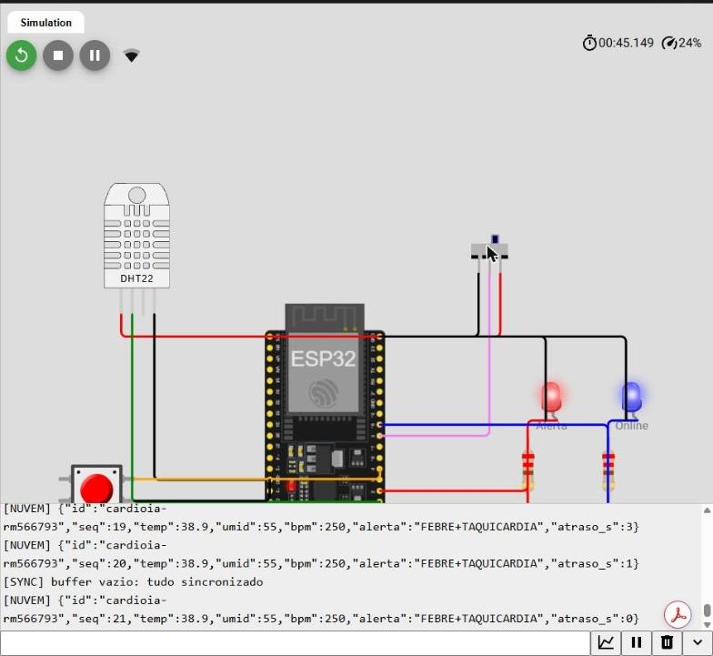
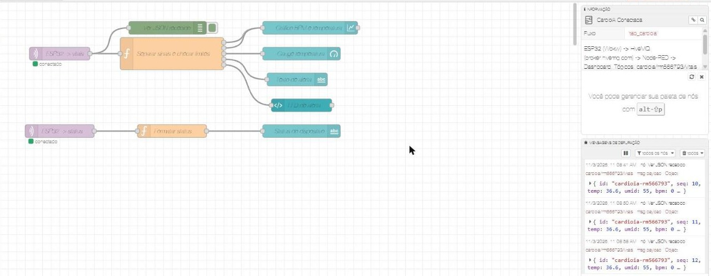
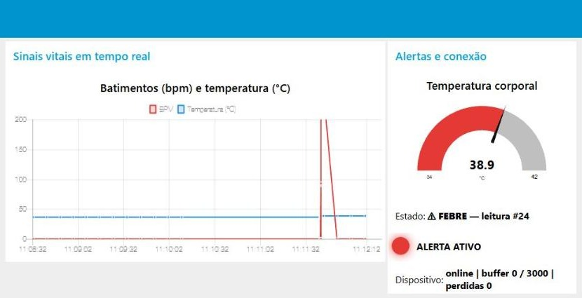
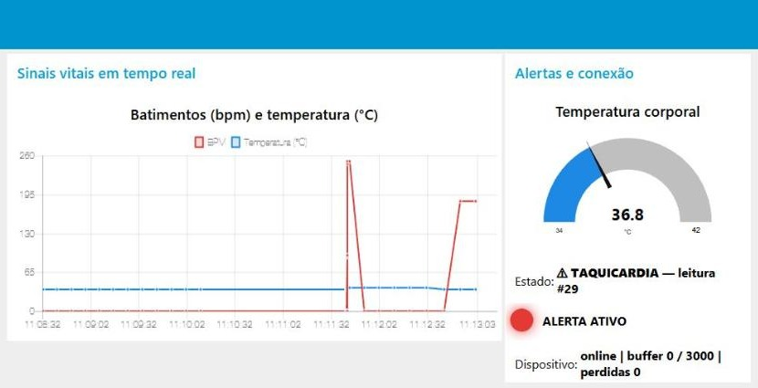
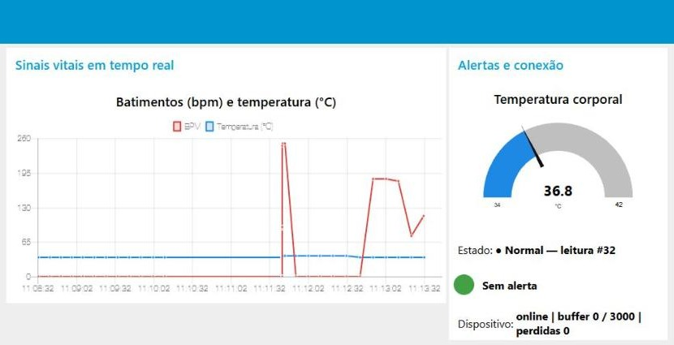

# CardioIA Conectada · Fase 3

FIAP, Inteligência Artificial, 2º ano (turma 2TIAOR)  
Marlon Paulino Marinho, RM566793 · Grupo 67 (faço o projeto sozinho)

Nesta fase, simulei no Wokwi um monitor cardíaco vestível que mede a temperatura e os batimentos de uma pessoa, guarda as medições quando a internet cai, envia tudo para a nuvem quando ela volta e mostra o resultado num painel com alertas. No desafio extra (Ir Além 1), um programa em Python recebe essas leituras por uma API e manda um e-mail para a equipe de saúde quando algo sai do normal.

## Links rápidos

| O quê | Onde |
|---|---|
| Simulação no Wokwi | https://wokwi.com/projects/479676068207522817 |
| Relatório da Parte 1 (armazenamento local) | [docs/relatorio_parte1_edge.pdf](docs/relatorio_parte1_edge.pdf) |
| Relatório da Parte 2 (MQTT e dashboard) | [docs/relatorio_parte2_mqtt_dashboard.pdf](docs/relatorio_parte2_mqtt_dashboard.pdf) |
| Relatório do Ir Além 1 (API REST e e-mail) | [docs/relatorio_ir_alem_1.pdf](docs/relatorio_ir_alem_1.pdf) |
| Código do Ir Além 1 | [ir_alem_1/](ir_alem_1/) |

## O problema

Quem tem problema no coração precisa ser acompanhado o tempo todo, inclusive em casa. Um aparelho vestível resolve parte disso, mas cria outro problema: a internet de casa cai, o celular fica sem sinal, o roteador reinicia. Se o aparelho só soubesse mandar dados ao vivo, cada queda viraria um buraco no histórico da pessoa, e talvez justamente na hora em que algo aconteceu.

Por isso o projeto foi pensado em camadas. O próprio aparelho já sabe guardar as medições e acender um alerta sozinho. A nuvem e o painel entram depois, para quem acompanha de longe.



## O que tem em cada pasta

| Pasta | Conteúdo |
|---|---|
| `esp32/` | Código do ESP32 (`sketch.ino`), circuito do Wokwi (`diagram.json`) e bibliotecas usadas (`libraries.txt`) |
| `node-red/` | Fluxo do Node-RED exportado (`flow_cardioia.json`), pronto para importar |
| `ir_alem_1/` | API REST, cliente, regras de risco, envio de e-mail, testes e uma saída de exemplo |
| `docs/` | Os três relatórios em PDF (e o texto original em Markdown) |
| `prints/` | Telas que comprovam o funcionamento |

## Como testar

### Parte 1 e Parte 2: o aparelho, a nuvem e o painel

1. Abra o link do Wokwi e clique no botão verde de iniciar.
2. A chave deslizante no canto funciona como o Wi-Fi. Para a esquerda, o aparelho fica offline. Para a direita, online.
3. Com a chave para a esquerda, veja no Monitor Serial as leituras sendo guardadas (`buffer 1/3000`, `2/3000`...).
4. Toque no botão vermelho no ritmo de um coração para gerar os batimentos. Clique no sensor DHT22 e suba a temperatura acima de 38 °C: o LED vermelho acende.
5. Passe a chave para a direita. O aparelho envia tudo o que guardou, na ordem certa, e o buffer volta a zero.

Para ver o painel, instale o Node-RED no computador (`npm install -g --unsafe-perm node-red`) e rode `node-red`. Abra `http://127.0.0.1:1880`, instale o pacote `node-red-dashboard` em *Manage palette*, importe o arquivo `node-red/flow_cardioia.json` e clique em *Deploy*. O painel fica em `http://127.0.0.1:1880/ui` e começa a receber os dados do Wokwi na hora.

### Ir Além 1: API REST e alerta por e-mail

Precisa de Python 3.10 ou mais novo.

```bash
cd ir_alem_1
pip install -r requirements.txt
python executar_demo.py
```

Esse comando liga a API, liga um "correio de teste" no próprio computador, simula 12 leituras de um paciente e mostra numa tabela o que aconteceu com cada uma. Os e-mails de alerta ficam salvos na pasta `ir_alem_1/caixa_de_entrada/` e abrem no Outlook ou no Bloco de Notas. Para conferir só as regras de risco, rode `python teste_regras.py`.

## Decisões que tomei e por quê

### Guardar até 3.000 leituras no aparelho

Cada leitura ocupa 12 bytes, então 3.000 leituras usam cerca de 36 KB, uma parte pequena da memória do ESP32. No uso real, com uma medição a cada 10 segundos, isso cobre mais de 8 horas sem internet, o suficiente para uma noite de sono. Se a memória encher, a leitura mais antiga dá lugar à mais nova, porque para a equipe de saúde o estado atual da pessoa importa mais do que o de horas atrás.

### Só apagar uma leitura depois que ela chegou

O aparelho tenta enviar e só tira a leitura da memória quando o envio dá certo. Cada leitura tem um número em sequência, o que permite ver se alguma se perdeu.

### Alerta em dois lugares

O ESP32 acende o LED mesmo sem internet. O Node-RED confere os mesmos limites quando os dados chegam. Se uma das partes falhar, a outra continua avisando.

### Broker público na demonstração

Usei o broker gratuito da HiveMQ porque ele funciona dentro do Wokwi sem cadastro. Ele não tem senha, então qualquer pessoa que souber o tópico consegue ler. Num produto de verdade, o certo seria o HiveMQ Cloud com conexão criptografada e usuário por aparelho.

### E-mail sem exagero

O robô do Ir Além 1 não repete o mesmo aviso em menos de 10 minutos, para a equipe não começar a ignorar os e-mails. Se a situação piorar (de "atenção" para "crítico"), o aviso sai na hora.

## Resultados

No teste registrado nos prints, o aparelho ficou offline e guardou 20 leituras. Cinco delas tinham febre, e três dessas também batimentos acima de 120 (toquei o botão bem rápido para provocar o alerta; por isso aparecem valores perto de 250). Ao voltar a internet, enviou as 20 na ordem, sem perder nenhuma. O painel mostrou os alertas de febre e de taquicardia e voltou ao normal quando os valores baixaram. No Ir Além 1, das 12 leituras simuladas, 5 geraram alerta e cada uma virou um e-mail. Na leitura 6, a febre já tinha sido avisada pouco antes, então o e-mail falou só da taquicardia, que era a novidade.

| Offline: leituras guardadas e LED aceso | Online: envio do que estava guardado | Fim da sincronização |
|---|---|---|
|  |  |  |



| Febre | Taquicardia | Normal |
|---|---|---|
|  |  |  |

O painel não depende só de cor para avisar: cada alerta aparece também escrito ("FEBRE", "TAQUICARDIA", "ALERTA ATIVO"), o que ajuda quem tem dificuldade para distinguir cores.

## Limites do protótipo

- Os batimentos vêm de toques num botão, não de um sensor de pulso real (como o MAX30102).
- O SPIFFS, a memória de arquivos do ESP32, não guarda nada no simulador. Por isso a reserva offline fica na memória RAM. Num ESP32 físico, a mesma lógica gravaria no SPIFFS ou num cartão microSD.
- Os limites de alerta são didáticos e não substituem a avaliação de profissionais de saúde.
- As mensagens não levam nome nem documento da pessoa, só um código do aparelho, pensando na LGPD.

## Glossário rápido

| Termo | O que quer dizer aqui |
|---|---|
| ESP32 | Pequeno computador com Wi-Fi, usado em aparelhos de IoT |
| Wokwi | Site que simula o ESP32 e os sensores no navegador |
| Buffer | Área de memória onde as leituras esperam até poderem ser enviadas |
| MQTT | Protocolo leve de mensagens: um lado publica num tópico, o outro assina |
| Broker | O "correio" do MQTT, que recebe e entrega as mensagens |
| Node-RED | Ferramenta visual para montar fluxos de dados ligando blocos |
| API REST | Forma padrão de sistemas conversarem pela web usando HTTP |
| SMTP | Protocolo usado para enviar e-mails |
| Edge, Fog e Cloud | Processar no aparelho, num computador próximo ou num servidor distante |
