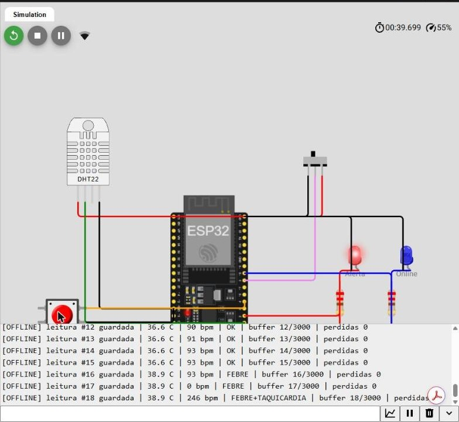
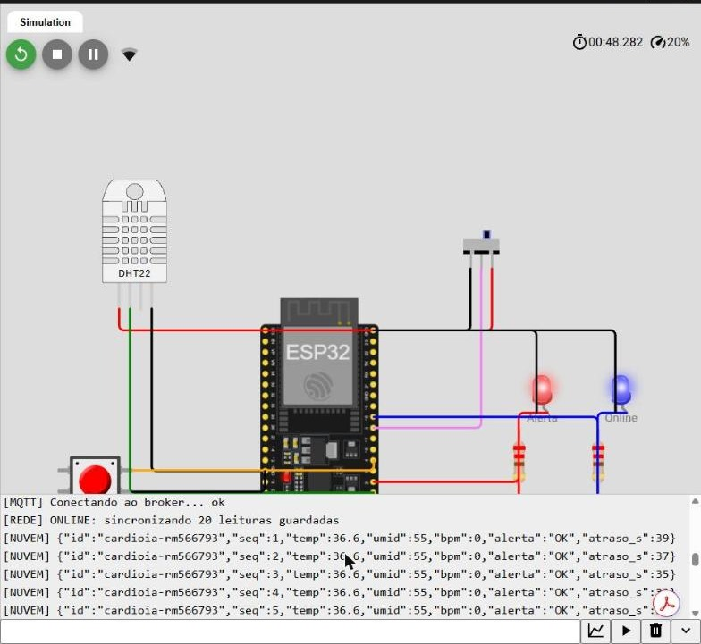

# Relatório — Parte 1: armazenamento e processamento local (Edge Computing)

**Projeto:** CardioIA Conectada — Fase 3  
**Aluno:** Marlon Paulino Marinho — RM566793  
**Simulação:** https://wokwi.com/projects/479676068207522817  
**Código:** `esp32/sketch.ino`

## 1. O que o protótipo simula

Um monitor cardíaco vestível. Um ESP32 lê dois sensores, guarda as leituras na própria placa quando não há internet e envia tudo quando a conexão volta. A ideia é que nenhuma leitura de um paciente cardiológico se perca por causa de uma queda de Wi-Fi.

| Componente | Pino | Papel |
|---|---|---|
| DHT22 (sensor 1, obrigatório) | GPIO 15 | Temperatura (°C) e umidade (%) |
| Botão "Batimento" (sensor 2) | GPIO 4 | Cada toque = 1 batimento; o código calcula o BPM |
| Chave deslizante | GPIO 5 | Simula o Wi-Fi: direita = online, esquerda = offline |
| LED vermelho | GPIO 2 | Acende quando há alerta clínico |
| LED azul | GPIO 18 | Acende quando está online e enviando |

## 2. Fluxo de funcionamento

A cada 2 segundos (na demonstração) o ESP32 executa o mesmo ciclo:

1. **Lê** temperatura e umidade do DHT22.
2. **Calcula o BPM** com os últimos 6 toques no botão. O tempo médio entre toques vira batimentos por minuto. Sem toque há mais de 6 s, o BPM é registrado como 0 (sem pulso detectado).
3. **Classifica** a leitura: FEBRE (> 38 °C), TAQUICARDIA (> 120 bpm), BRADICARDIA (< 50 bpm com pulso) ou OK. Com alerta, o LED vermelho acende na hora, mesmo offline. O alerta local não depende da nuvem.
4. **Guarda** a leitura no buffer local, **sempre**, com ou sem internet.
5. **Verifica a conexão** pela variável booleana `wifiSimulado()`, ligada à chave deslizante.
   - **Offline:** mostra no Monitor Serial `[OFFLINE] leitura #N guardada | buffer N/3000` e segue coletando.
   - **Online:** envia as leituras guardadas, da mais antiga para a mais nova, pelo `Serial.println` (`[NUVEM] {...}`) e por MQTT. Cada leitura só é apagada do buffer **depois** de ser enviada com sucesso.

## 3. Lógica de resiliência offline

**Onde guardar.** O enunciado pede SPIFFS, mas o próprio material explica que, no Wokwi, o SPIFFS é volátil e some ao fim da simulação. Por isso usamos um **buffer circular na RAM** do ESP32, com o Monitor Serial como registro da sincronização. Num aparelho físico, o mesmo buffer seria gravado em SPIFFS ou cartão microSD sem mudar a lógica.

**Quanto guardar (estratégia de armazenamento limitado).** O buffer tem **3.000 amostras**. Cada amostra ocupa 12 bytes (número da leitura, momento, temperatura ×10, umidade e BPM). Total de cerca de 36 KB, cerca de 11% da RAM do ESP32.

O número vem do modelo de uso. No produto real, o vestível mede uma vez a cada 10 segundos. Então 3.000 amostras cobrem **8 h 20 min sem internet**, o equivalente a uma noite de sono ou um turno. É o cenário mais comum de perda de sinal para um paciente em casa.

**Quando o buffer enche.** Ele funciona como fila (FIFO). A leitura mais antiga é sobrescrita pela nova, e o contador `perdidas` registra quantas foram descartadas. Escolhemos descartar a mais antiga porque, para o cardiologista, o estado atual do paciente vale mais que o de 8 horas atrás.

**Envio sem travar.** Ao voltar online, o ESP32 envia no máximo 25 leituras por volta do `loop()`. Assim, mesmo com 3.000 leituras guardadas, ele continua lendo os sensores e acendendo o alerta durante a sincronização.

**Sem duplicar e sem perder.** Cada leitura tem um número sequencial (`seq`) e o campo `atraso_s`, que diz há quantos segundos ela foi medida. O painel mostra se o dado é "ao vivo" ou "veio do buffer", e um buraco na sequência denuncia perda.

## 4. Resultado do teste

No teste registrado nos prints, o ESP32 ficou offline e guardou 20 leituras (buffer 20/3000). No meio do teste, a temperatura do DHT22 subiu para 38,9 °C e o botão foi tocado rapidamente. O próprio ESP32 classificou as leituras como FEBRE e FEBRE+TAQUICARDIA e acendeu o LED vermelho, ainda sem internet.

Ao passar a chave para online, o Serial mostrou `[REDE] ONLINE: sincronizando 20 leituras guardadas`. As leituras saíram em ordem (`seq` 1, 2, 3...), cada uma com o atraso real (`atraso_s` 39, 37, 35...), e o processo terminou com `[SYNC] buffer vazio: tudo sincronizado`. Nenhuma leitura foi perdida (`perdidas 0`).

## 5. Como testar no Wokwi

1. Inicie a simulação com a chave na **esquerda (offline)**. O Serial mostra `[OFFLINE] ... buffer 1/3000`, `2/3000`...
2. Toque o botão em ritmo constante para gerar BPM. Clique no DHT22 e suba a temperatura acima de 38 °C: o LED vermelho acende.
3. Passe a chave para a **direita (online)**. O Serial mostra `[REDE] ONLINE: sincronizando N leituras`, as linhas `[NUVEM] {...}` e, ao final, `[SYNC] buffer vazio`.
