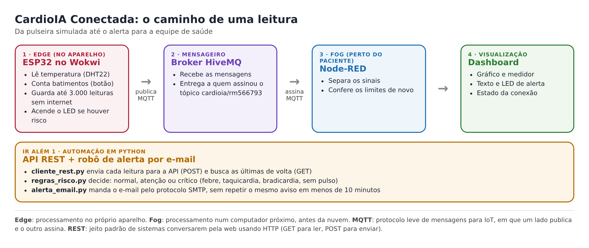
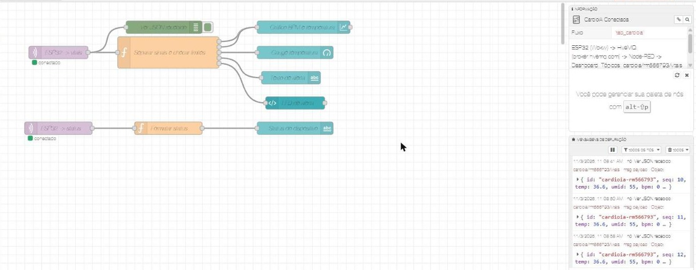
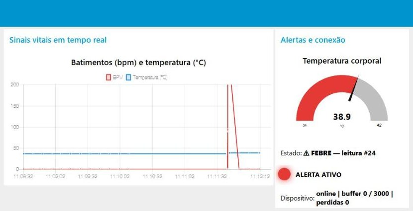
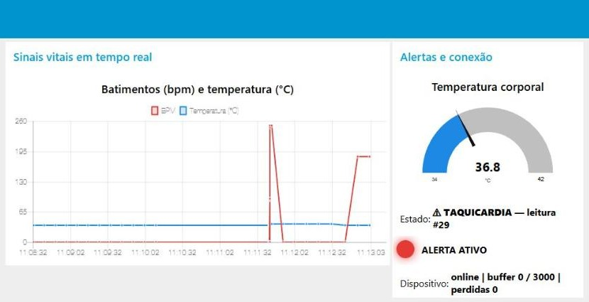
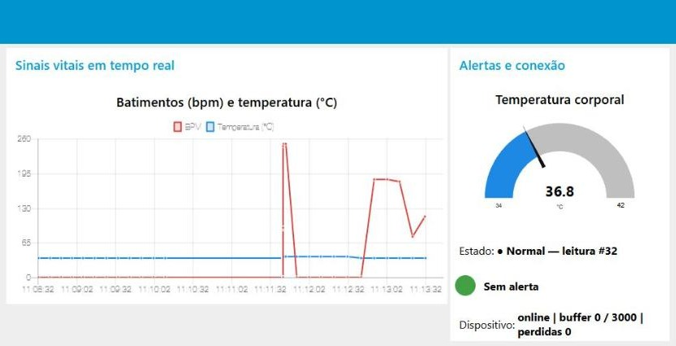

# Parte 2: envio para a nuvem e painel de acompanhamento

**CardioIA Conectada, Fase 3** · Marlon Paulino Marinho, RM566793 · Grupo 67  
Simulação: https://wokwi.com/projects/479676068207522817 · Arquivos: `esp32/sketch.ino` e `node-red/flow_cardioia.json`

## A visão geral

Na Parte 1, o ESP32 mede e guarda as leituras. Nesta parte, elas saem do aparelho e chegam a um painel que uma equipe de saúde poderia acompanhar de longe. O caminho tem quatro paradas:



1. O ESP32 publica cada leitura.
2. O broker HiveMQ recebe e entrega a quem pediu para receber.
3. O Node-RED, rodando no meu computador, recebe, confere os limites e organiza os dados.
4. O painel (dashboard) mostra tudo em tempo real.

O Node-RED representa a camada *fog*, um computador perto da pessoa que trata os dados antes de irem para longe. O broker representa a nuvem.

## Como as mensagens viajam: o MQTT

Para levar os dados usei o MQTT, um protocolo de mensagens feito para aparelhos pequenos e redes instáveis. Ele funciona como uma assinatura de jornal: quem produz a notícia publica num tópico, que é como o nome de uma seção, e quem quer ler assina aquele tópico. O ESP32 publica sem saber quem vai ler. A ponte entre os dois é o broker, o "correio" do MQTT.

Preferi o MQTT a um envio por HTTP a cada leitura principalmente porque a conexão fica aberta o tempo todo. O aparelho não precisa abrir uma conversa nova para cada leitura, as mensagens ficam menores e, quando o sinal cai, reconectar é simples.

### O broker

Usei o broker público da HiveMQ (`broker.hivemq.com`, porta 1883). Ele funciona dentro do Wokwi e não pede cadastro, o que facilita para quem for corrigir. A contrapartida é que ele não tem senha. Na seção de segurança, mais abaixo, explico o que mudaria num produto real.

### Os tópicos

Coloquei meu RM no nome dos tópicos para meus dados não se misturarem com os de outras pessoas que usam o mesmo broker público.

| Tópico | Quem publica | O que leva |
|---|---|---|
| `cardioia/rm566793/vitais` | ESP32 | Uma leitura por mensagem |
| `cardioia/rm566793/status` | ESP32 | Se o aparelho está online e quantas leituras estão guardadas |

### O formato de cada leitura

Usei JSON, que é texto organizado em pares nome e valor:

```json
{"id":"cardioia-rm566793","seq":42,"temp":36.6,"umid":55,"bpm":84,"alerta":"OK","atraso_s":0}
```

`seq` é o número da leitura, que mostra se alguma faltou. `atraso_s` diz há quantos segundos ela foi medida: zero quando é ao vivo e mais que zero quando veio da reserva offline. `alerta` já chega classificado pelo próprio aparelho, para o caso de a nuvem estar fora do ar.

**O caminho de uma mensagem, passo a passo:**

1. Ao ligar, o ESP32 entra no Wi-Fi do simulador e abre a conexão com o broker usando um nome único.
2. Nessa conexão ele deixa registrado um "último recado" (em inglês, *Last Will*): se a conexão cair de repente, o próprio broker publica no tópico de status que o aparelho está desconectado. Assim o painel percebe a queda mesmo que o aparelho não consiga avisar.
3. A cada leitura, o ESP32 publica no tópico `vitais`.
4. O broker entrega a mensagem ao Node-RED, que assinou esse tópico.
5. Se uma publicação falha, a leitura continua guardada no aparelho e é enviada de novo na próxima tentativa.
6. Sem conexão, o ESP32 tenta reconectar a cada 5 segundos, sem parar de medir.

### O nível de garantia de entrega

O MQTT tem três níveis de garantia (QoS 0, 1 e 2). Usei o 0, o mais leve, porque a garantia já está no próprio aparelho: a leitura só sai da memória depois de enviada, e a numeração denuncia qualquer falta. Num produto real eu passaria para o QoS 1 ("entrega pelo menos uma vez") e usaria o número da leitura para descartar repetidas.

## Como montei o painel no Node-RED

O Node-RED é uma ferramenta em que o tratamento dos dados é montado ligando blocos com setas, em vez de escrever um programa inteiro. Cada bloco se chama **nó**. Instalei o Node-RED no meu computador e o pacote `node-red-dashboard`, que traz os blocos de gráfico, medidor e texto. O fluxo completo está no arquivo `node-red/flow_cardioia.json` e pode ser importado pelo menu *Import*.

| Nó | O que faz |
|---|---|
| ESP32 -> vitais | Assina o tópico das leituras e já transforma o texto JSON em dados |
| Separar sinais e checar limites | Divide a leitura entre os elementos do painel e confere de novo os limites de alerta |
| Gráfico BPM e temperatura | Linha do tempo com os batimentos (vermelho) e a temperatura (azul) dos últimos 10 minutos |
| Gauge temperatura | Medidor de 34 a 42 °C: azul até 37,5, verde até 38 e vermelho acima disso |
| Texto de alerta | Escreve "Normal" ou o nome do alerta, o número da leitura e se ela veio da reserva |
| LED de alerta | Círculo verde quando está tudo bem e vermelho quando há alerta |
| ESP32 -> status | Mostra se o aparelho está online, quantas leituras estão guardadas e se alguma se perdeu |
| Ver JSON recebido | Mostra cada mensagem bruta na lateral do editor, para conferência |

**Os limites de alerta que defini:**

| Sinal | Limite | Alerta |
|---|---|---|
| Temperatura | acima de 38,0 °C | FEBRE |
| Batimentos | acima de 120 por minuto | TAQUICARDIA |
| Batimentos | abaixo de 50 por minuto (com pulso) | BRADICARDIA |

Coloquei a regra em dois lugares. No ESP32 ela acende o LED mesmo sem internet. No Node-RED ela é conferida de novo quando o dado chega. Assim dá para ajustar os limites no painel sem regravar o aparelho, e o alerta continua funcionando se uma das partes falhar.

## O que o teste mostrou

Fiz o teste em 03/11/2026, com o ESP32 no Wokwi e o Node-RED no meu computador. As duas entradas MQTT ficaram com o status "conectado" e cada leitura apareceu na lateral do editor.









Um detalhe do gráfico: o primeiro pico de batimentos aparece quase em pé porque as 20 leituras guardadas offline chegaram todas de uma vez. O gráfico usa a hora de chegada, não a hora da medição. O texto de estado compensa isso e avisa quando a leitura veio da reserva.

## Eficiência, segurança e cuidado com quem usa

### Eficiência

Cada mensagem tem cerca de 100 caracteres. Com uma leitura a cada 10 segundos, isso dá cerca de 1 MB por dia por pessoa monitorada.

### Privacidade

Dado de saúde é dado pessoal sensível pela LGPD. Por isso a mensagem não leva nome nem documento, só o código do aparelho. A ligação entre aparelho e pessoa ficaria guardada no sistema do hospital, e não no broker.

### Segurança num produto real

O broker público serve para a demonstração, mas qualquer pessoa que souber o nome do tópico consegue ler as mensagens. Num produto de verdade eu usaria o HiveMQ Cloud com conexão criptografada (TLS, porta 8883), usuário e senha para cada aparelho e permissão só para o próprio tópico. As senhas ficariam fora do código e nunca iriam para um repositório público.

### Acessibilidade

O painel não depende só da cor: cada alerta também aparece escrito, o que ajuda quem tem dificuldade para distinguir vermelho e verde.

### Limites do protótipo

Os batimentos vêm de toques num botão, e não de um sensor de pulso de verdade (como o MAX30102). Os limites de alerta são didáticos e não substituem a avaliação de profissionais de saúde.
